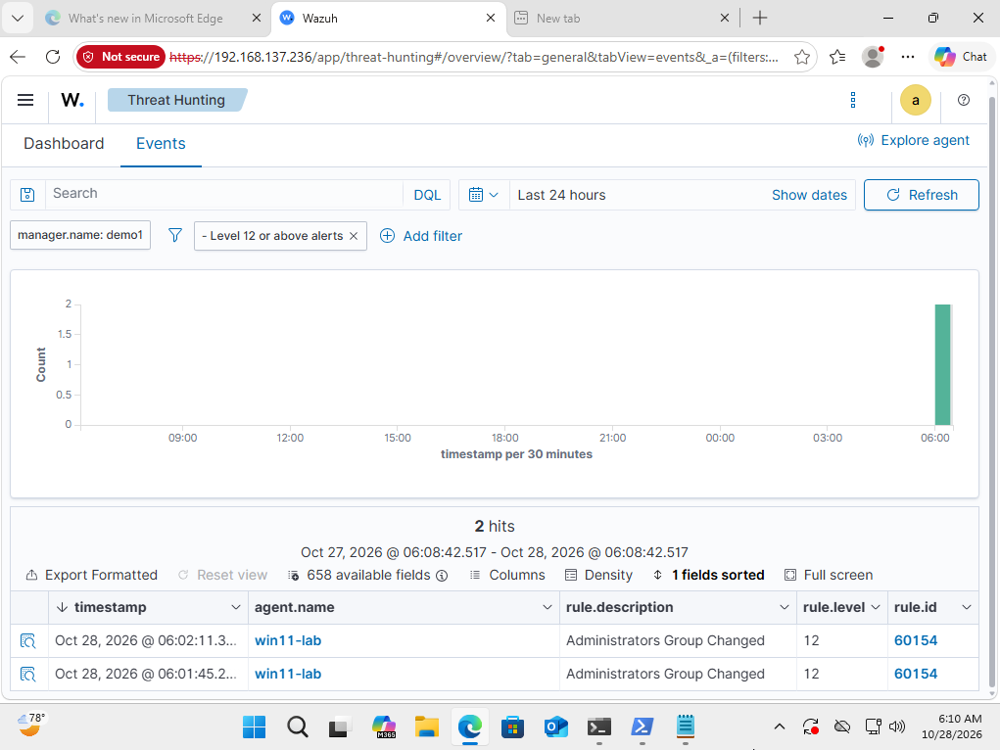
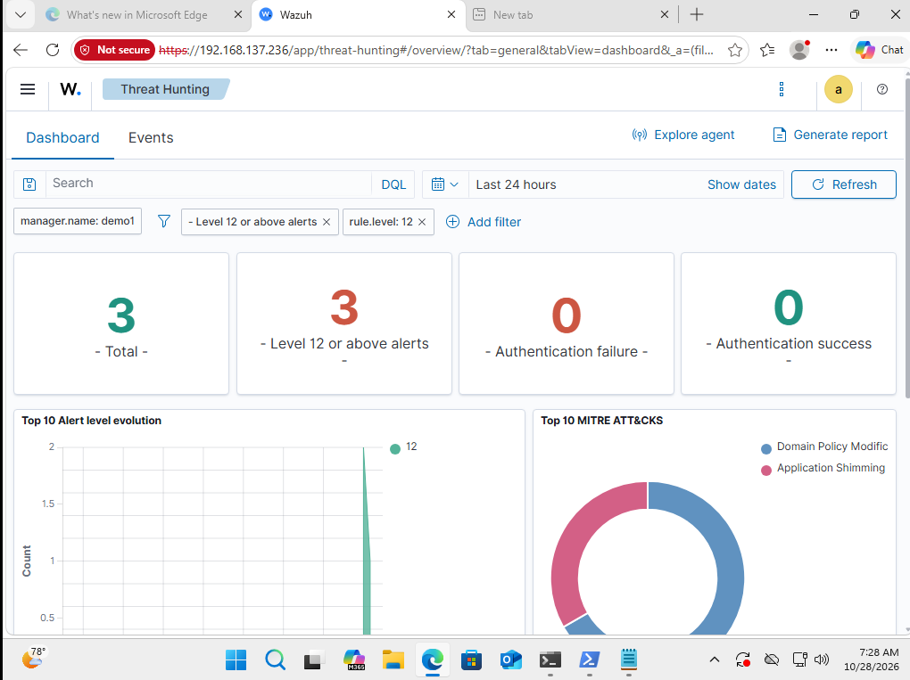
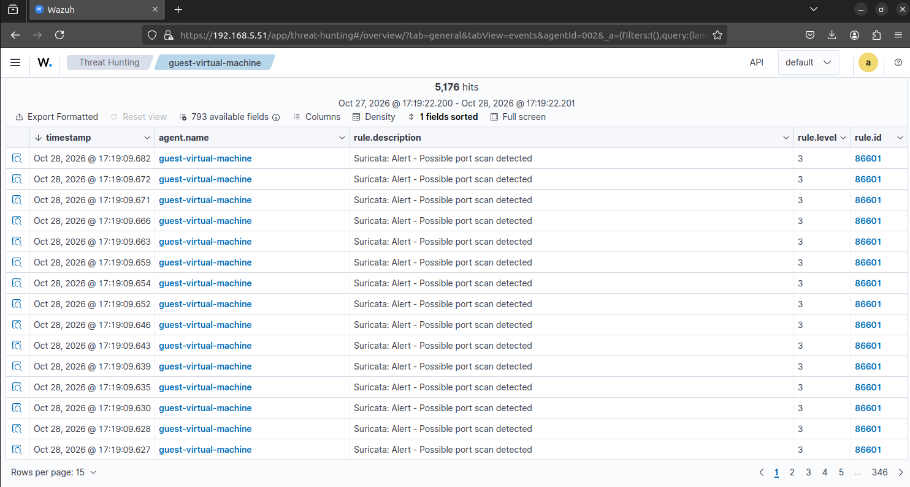
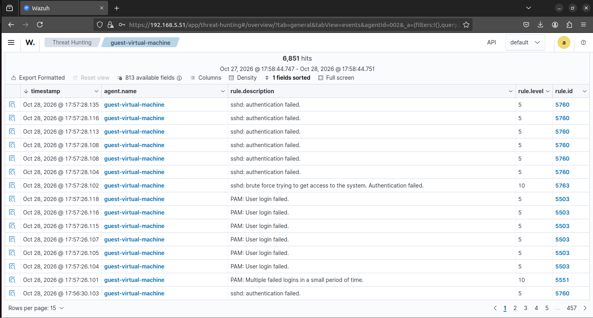

# Home SOC with Wazuh

## Requirements

Three virtual machines on the same network:
- Ubuntu Server (Wazuh server)
- Kali Linux (attacker)
- Windows 11

## Setup

1. Install the Wazuh server on the Ubuntu Server VM. When the installation finishes, it prints a username and a default password, which you can change later.
2. Access the dashboard in a browser at `https://<ubuntu-server-ip>:443`.
3. Deploy an agent. In the Wazuh dashboard, go to **Agents → Deploy new agent**, then install the agent on the Windows VM.
4. Install Sysmon on the Windows VM for better visibility, so Wazuh collects the Sysmon event channel.
5. Move to the Linux VM and deploy a Wazuh agent on it as well — same steps as the Windows VM.
6. Install Suricata on the Linux VM and feed its alerts into Wazuh.

### Issue encountered

After installation, I could not log in with the default password. I had to change the password before I could access the dashboard.

## Lab Test 1: Admin Group Change Detection

To test detection, I created a new user on the Windows VM, added it to the Administrators group, and then deleted it.

In the Wazuh dashboard, I went to **Threat Hunting** and found that Wazuh had flagged the activity as **Administrators Group Changed** (rule ID 60154, level 12). Each alert included fields such as rule ID, rule description, level, and MITRE ATT&CK mapping.

I expanded an alert and opened the JSON view, which showed these fields:
- `rule.mitre.id`
- `rule.mitre.technique`
- `data.win.eventdata.subjectUserName`
- `data.win.eventdata.targetUserName`

`subjectUserName` shows who made the change, and `targetUserName` shows the group that was changed (the Administrators group itself, rather than the account added to it).

*The figure above shows the Administrators Group Changed alert (rule ID 60154, level 12) in Threat Hunting.*

*The figure above shows the Threat Hunting dashboard, including the MITRE ATT&CK mapping for the alert.*

## Lab Test 2: Port Scan Detection with Suricata

I ran a port scan from the Kali VM against the Ubuntu VM. Suricata detected the scan and forwarded the alert to Wazuh. In the Wazuh dashboard, I went to **Threat Hunting** and found the activity flagged as **Possible Port Scan Detected** (rule ID 86601, level 3).

*The figure above shows the alert in Threat Hunting.*

## Lab Test 3: SSH Brute-Force

I performed an SSH brute-force attack against the Ubuntu VM using Hydra. Wazuh flagged the activity as **SSH brute force** (rule ID 5763, level 10).

*The figure above shows the flagged alert for SSH brute-force.*
